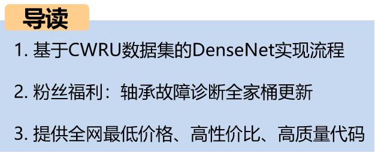
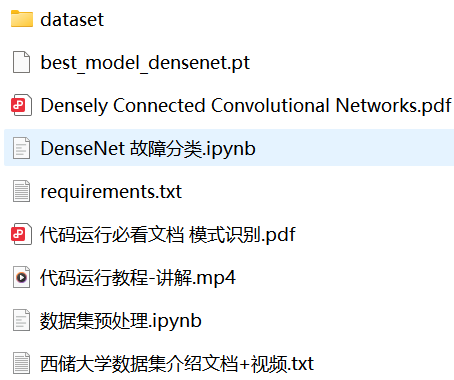
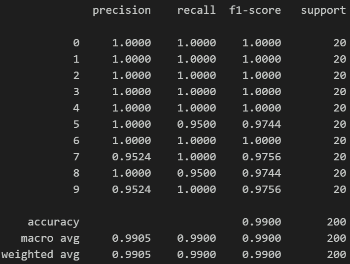

# DenseNet Fault Diagnosis Model Based on Density Connectivity: Achieving High Robustness in Deep Fault Diagnosis

1. DenseNet Introduction
1.1 Model Overview
DenseNet (Densely Connected Convolutional Network) is a deep convolutional neural network architecture proposed by Gao Huang et al. in 2016. Its core innovation lies in the introduction of "dense connectivity" mechanism, which means that every layer in the network directly connects to the feature maps of all previous layers. This design effectively promotes feature reuse and gradient propagation, significantly mitigating the problem of gradient vanishing in deep networks.

1.2 Network Architecture Overview
DenseNet enhances information flow and diversity of features through concatenating the input features of each layer with the output features of all previous layers. This structure allows the network to achieve high performance even with relatively fewer parameters. Additionally, DenseNet is well-structured, divided into multiple Dense Blocks and transition layers, making it easy to design and expand.

1.3 DenseBlock Overview
The DenseBlock is a key component of DenseNet, responsible for dense connections between layers. It consists of two parts: the first part is a set of convolutional layers, while the second part is a set of fully connected layers. The convolutional layers extract spatial features from the input data, while the fully connected layers perform dimensionality reduction and feature extraction.

1.4 TransitionLayer Overview
TransitionLayer is used to connect different DenseBlocks in the network. It takes the output features of one DenseBlock as input and passes them through a set of convolutional layers to generate new features. This process helps to maintain the consistency of the network's representation across different layers.

2. Accuracy Assessment
2.1 Test Set Accuracy
The test set accuracy of this implementation is 99%. This indicates that the model has achieved high performance on the test data.

2.2 User Scenarios
This implementation is suitable for beginners, those who need papers, and those who need to complete their graduation projects.

2.3 Code Quality
The code provided here is detailed with comments, ensuring that anyone can run and learn from it without any difficulty.
(1)Initial Convolution Layer
The input data is first processed through a standard convolution layer (typically 7x7 size, stride of 2, or smaller convolutional kernels such as 3x3), which extracts preliminary features from the input and often accompanied by Batch Normalization and ReLU activation.

Next, max pooling is typically used to reduce spatial dimensions.

(2) Dense Block
A core module consisting of multiple dense layers.
Dense connectivity: Any layer in the Dense Block receives the feature maps from all previous layers as input, input is in the form of a concatenated tensor.
Each dense layer contains the following operations in sequence:
Batch Normalization
ReLU activation
1×1 convolution (bottleneck layer, reducing computational load)
Batch Normalization
ReLU activation
3×3 convolution
Each layer produces a fixed number of output feature channels (growth rate), and these new features are combined with all previous layer features, passed on to the next layer.

(3) Transition Layer
Used to connect two Dense Blocks, containing the following layers:
Batch Normalization
1×1 convolution, used to reduce the number of feature channels (often halving the channel count)
2×2 average pooling, used for downsampling spatial dimensions
Transition layer reduces the size and number of channels of the feature map, which helps control model complexity and computational load. 
DenseNet's tight connection method and stacking structure have achieved outstanding performance in multiple computer vision tasks, with high parameter utilization efficiency and more stable training. 
2 Data Preprocessing for CWRU Data
2.1 Import Data
Refer to previous articles for data preprocessing for fault classification, using the Case Western Reserve University bearing data for the 10-class classification dataset:

2.2 Data Set Preprocessing
Create datasets by sliding windows and uniformly divide the training set, validation set, and test set into 7:2:1 ratios, finally saving the data.
3 Fault Diagnosis Model Based on DenseNet
3.1 Define the network model, set parameters, and train the model
50 epochs, accuracy 99%, DenseNet network significantly improves classification results with a 99% accuracy rate, extracting important features from fault signal characteristics that are crucial for model recognition, showing significant advantages:
(1) Efficient feature extraction capability
DenseNet's unique dense connection structure can fully utilize multi-layer feature information from shallow to deep layers, effectively capturing key features at different scales in bearing vibration signals. This enables the model to precisely differentiate between various types of faults such as pitting, wear, and cracks.
(2) Alleviates gradient vanishing and improves training stability
Deep neural networks often encounter gradient vanishing issues during training, affecting performance and convergence speed. DenseNet promotes gradient flow through inter-layer dense connections, making model training more stable and converge faster, which helps improve the accuracy of fault diagnosis.
(3) High parameter utilization efficiency, suitable for resource-constrained environments
The DenseNet model, thanks to its feature reuse, is highly efficient in parameter utilization compared to traditional deep networks. It has fewer parameters but performs better. This is particularly important for real-world applications that require embedded or edge devices for online bearing monitoring.
In summary, the structural advantages of DenseNet make it an excellent choice for bearing fault diagnosis. It can provide more accurate, real-time, and reliable intelligent diagnostic solutions for industrial equipment maintenance, promoting the development of intelligent manufacturing and equipment health management.
Model Evaluation:
(1) Accuracy, Precision, Recall, F1 Score
(2) Fault Classification Confusion Matrix:
3 Update Download
(1) 27 Bearing Fault Diagnosis Models | The Most Affordable Full Set Online
27 Bearing Fault Diagnosis Models | The Most Affordable Full Set Online
Download Link:
Previously Interesting Content
Python-Case Western Reserve University (CWRU) Bearing Data Interpretation and Classification Process
Python Bearing Fault Diagnosis (Part I) Short-Time Fourier Transform STFT
Python Bearing Fault Diagnosis (Part II) Continuous Wavelet Transform CWT
Python Bearing Fault Diagnosis (Part III) Empirical Mode Decomposition EMD
Pytorch-LSTM Bearing Fault One-Dimensional Signal Classification (Part I)
Pytorch-CNN Bearing Fault One-Dimensional Signal Classification (Part II)
Pytorch-Transformer Bearing Fault One-Dimensional Signal Classification (Part III)
Python Bearing Fault Diagnosis (Part IV) Based on EMD-CNN Fault Classification
Python Bearing Fault Diagnosis (Part V) Based on EMD-LSTM Fault Classification
Python Bearing Fault Diagnosis (Part VI) Based on EMD-Transformer Fault Classification
Python Bearing Fault Diagnosis (Part VII) Based on EMD-CNN-LSTM Fault Classification
Python Bearing Fault Diagnosis (VIII) Parallel Model Based on EMD-CNN-GRU for Fault Classification
Fault Identification Model for Bearing Based on FFT + CNN - BiGRU-Attention: Attention to Time and Frequency Characteristics
Fault Identification Model for Bearing Based on FFT + CNN - Transformer: Attention to Time and Frequency Characteristics
Python Bearing Fault Diagnosis (IX) Parallel Model Based on VMD+CNN-BiLSTM for Fault Classification
Python Bearing Fault Diagnosis (X) Parallel Model Based on VMD+CNN-Transformer for Fault Classification
Python Bearing Fault Diagnosis (11) Parallel Model Based on VMD+CNN-BiGRU-Attention for Fault Classification
Cross Attention Fusion of Time and Frequency Features with FFT + CNN - BiLSTM-CrossAttention Bearing Fault Identification Model
Cross Attention Fusion of Time and Frequency Features with FFT + CNN-Transformer-CrossAttention Bearing Fault Identification Model
Introduction to Python Bearing Fault Diagnosis
Python Bearing Fault Diagnosis (13) Super-strong Machine Learning Identification Model Based on Fault Signal Feature Extraction
Python Bearing Fault Diagnosis (14) Highly Innovative Fault Identification Model
Python Bearing Fault Diagnosis (15) One-Dimensional Fault Signal Identification Model Based on CNN-Transformer
Python Bearing Fault Diagnosis (16) Highly Innovative Fault Identification Model (II)
SCI 1st Region Highly Innovative Bearing Fault Diagnosis Model!
Python Bearing Fault Diagnosis (18) Innovative Diagnosis Model Based on CNN-TCN-Attention
Highly Innovative Bearing Fault Diagnosis Model Based on GADF+Swin-CNN-GAM
Attention Magic Modification | Super-strong Bearing Fault Diagnosis Model!
Bearing Faults—Cross Attention Innovation Model Complete Kit
Python Bearing Fault Diagnosis (19) Innovative Diagnosis Model Based on Transformer-BiLSTM
END

## Images

<!-- PAYMENT_BLOCK -->

## Get this dataset

- Payment link (Stripe): [Buy now](https://buy.stripe.com/3cs8yP7sY87d0vu9AB)
- Payment QR code: 

<!-- /PAYMENT_BLOCK -->
